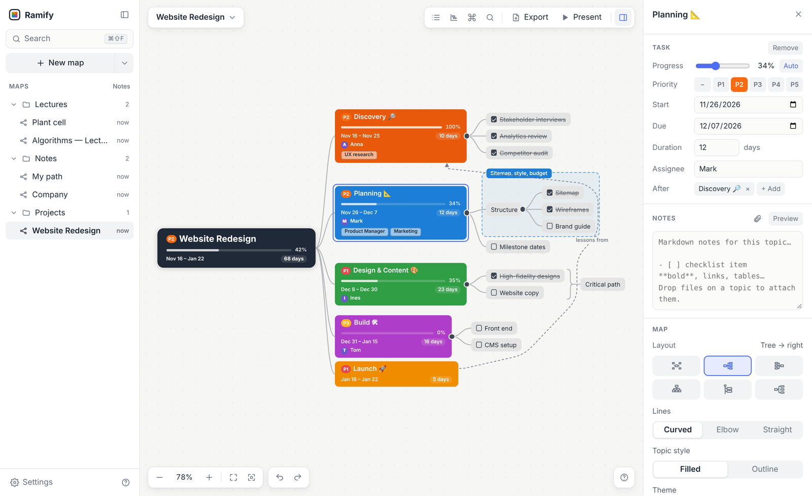
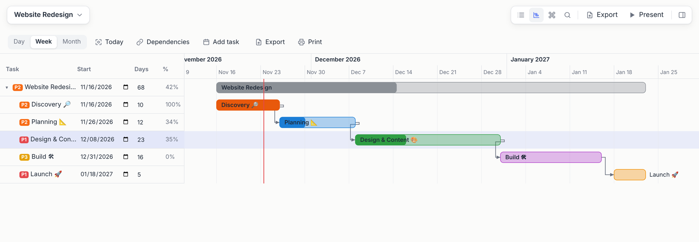
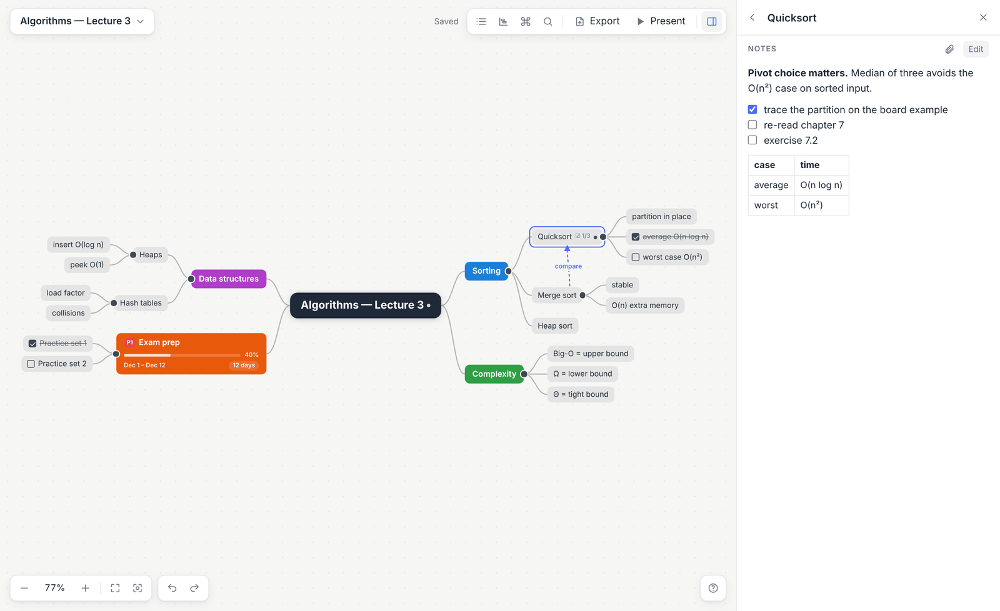
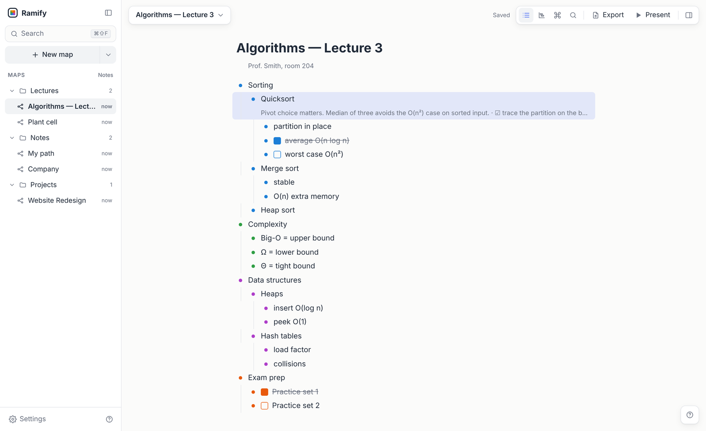
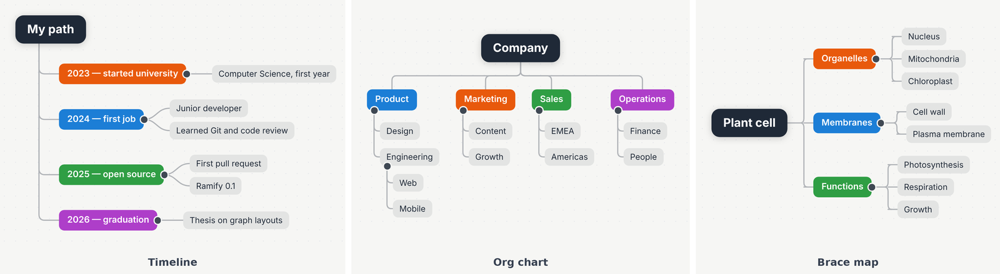
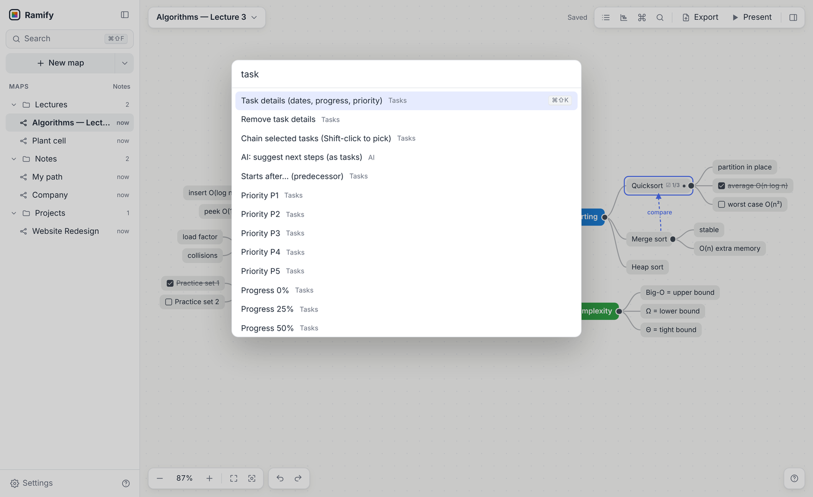
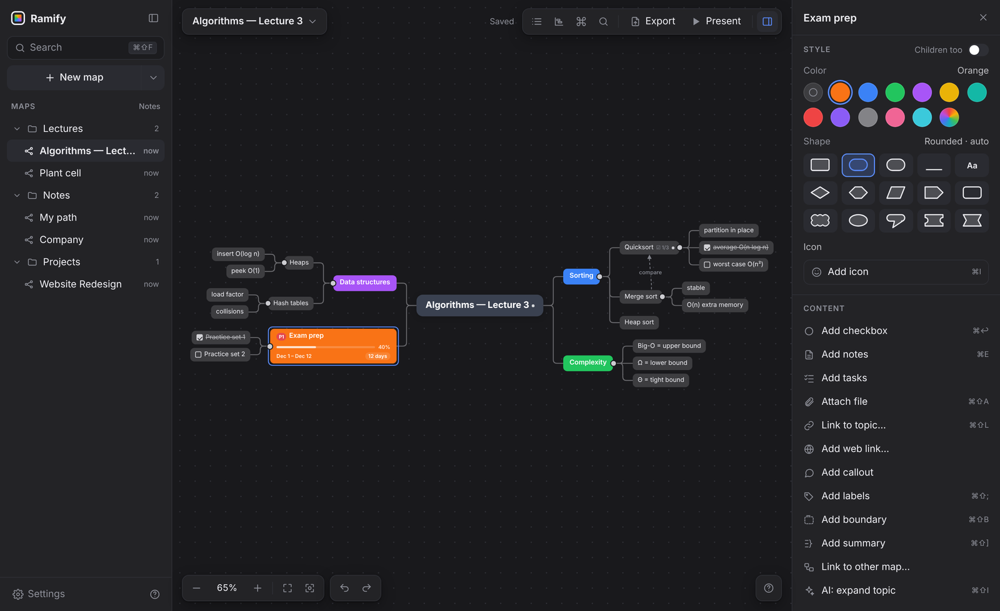

# Ramify

**A keyboard-first mind map for notes and plans.** Take lecture and meeting notes as fast as you type, then turn a map into a project plan: tasks with dates, priorities and owners, and a Gantt chart that stays in sync with the map. Every map is a plain Markdown file in a folder you choose. Free and open source.



*ramify* (v.): to branch out.

## Install

**macOS** (Homebrew)

```bash
brew tap almazy/tap
brew trust almazy/tap
brew install --cask ramify
```

**macOS** (manual): download the `.dmg` from [Releases](https://github.com/ALMAZY/ramify/releases/latest).

**Windows:** download the `.msi` or the `-setup.exe` from [Releases](https://github.com/ALMAZY/ramify/releases/latest).

**Linux:** download from [Releases](https://github.com/ALMAZY/ramify/releases/latest), for x64 or arm64:

- `.deb` for Debian, Ubuntu and Mint: `sudo apt install ./Ramify_*.deb`
- `.rpm` for Fedora and openSUSE: `sudo dnf install ./Ramify-*.rpm`
- `.AppImage` for any distro: `chmod +x Ramify_*.AppImage && ./Ramify_*.AppImage`

> **First launch.** The builds are not signed with a paid certificate yet, so your system may warn you once.
> - **macOS** (if you used the `.dmg`): open **System Settings → Privacy & Security** and click **Open Anyway**. You can also run `xattr -dr com.apple.quarantine /Applications/Ramify.app`. Homebrew installs skip this step.
> - **Windows** SmartScreen: click **More info → Run anyway**.

## What it can do

### Plan a project on the map

Select a topic and press `⌘⇧K` to give it task details: progress, priority (P1–P5), start and due date, duration, an assignee and the tasks it waits for. The topic shows them as a badge, a progress bar and dates. Group work with a **boundary** (`⌘⇧B`), sum up topics with a **brace** (`⌘⇧]`, Shift-click to pick several), and tag topics with **labels** (`⌘⇧;`). See the screenshot at the top.

### See it as a Gantt chart



Press `⌘3` (or the chart button in the toolbar). Drag a bar to move it, drag its ends to change the dates, and drag the knob under it to set progress. Tasks that wait for it move along. To chain tasks, Shift-click them in order and press **Dependencies**. Day, week and month zoom. Export as PNG, JPEG, PDF, Excel (CSV) or Calendar (.ics), or print.

### Take notes fast



Type a topic, `Tab` for a child, `Enter` for the next one. `⌘E` opens the topic's notes in the side panel: Markdown with checklists, tables, links and attachments. In notes, Enter continues a list (`- [ ]` tasks, bullets, numbers).

### Edit it as an outline



`⌘2` shows the same map as a list. It's the fastest way to type during a lecture. `⌘1` goes back to the map.

### Pick a layout



Mind map, tree right, tree left, org chart, timeline and brace map (`⌘L`, or the style panel), with curved, elbow or straight lines. Each map remembers its own layout.

### Do everything from the keyboard



`⌘K` finds any command. `?` lists every shortcut.

### 16 themes



Light, dark and in between, with a live preview (`⌘⇧T`).

## Features

| | |
|---|---|
| **Keyboard-first** | Build and navigate whole maps without the mouse. `?` shows every shortcut. |
| **Command palette** | Every action on `⌘K`, with fuzzy search. |
| **Rich notes** | Markdown notes on any topic (`⌘E`): bold, links, tables, code, rendered in place. |
| **Task lists** | Checkbox topics (`⌘↩`) and `- [ ]` checklists inside notes, with a progress chip on the topic. In notes, Enter continues a list (tasks, bullets, numbers). |
| **Task details** | Progress, priority (P1–P5), start and due dates, duration, assignee and "starts after" for any topic (`⌘⇧K`). Shown on the topic as a progress bar and dates. |
| **Gantt chart** | `⌘3`: every dated topic on a timeline. Drag bars to move or resize, drag the knob to set progress; tasks that come after move along. Shift-click tasks and press *Dependencies* to chain them. Export PNG, JPEG, PDF, Excel (CSV) or Calendar (.ics), or print. |
| **Summary & boundary** | A brace that sums up several topics (`⌘⇧]`, Shift-click to pick them) and a dashed box with a label around a branch (`⌘⇧B`). |
| **Labels** | Small tags under a topic, e.g. roles or owners (`⌘⇧;`). |
| **Attachments** | Drop images, PDFs or any file on a topic, or press `⌘⇧A`. Images show on the map. |
| **Cross-links** | Connect any two topics with a dashed arrow (`⌘⇧L`), with optional text on it. Jump along with `⌘G`. Link to a topic in another map too. |
| **Daily notes** | `⌘⇧D` opens today's map in `Daily/YYYY-MM-DD.md`, the same naming as Obsidian. |
| **Search** | `⌘F` finds in the current map, `⌘⇧F` searches every map (text and notes). |
| **Node styles** | 9 colours plus any custom colour, 4 shapes, and 60+ icons. |
| **16 themes** | Light, dark and in between, with a live preview (`⌘⇧T`). |
| **6 layouts** | Mind map, tree right, tree left, org chart, timeline, brace map (`⌘L`), with curved, elbow or straight lines. Saved per map. |
| **Outline view** | Edit the same map as a list (`⌘2`), the fastest way to type in a lecture. |
| **Folders** | Organise maps in sub-folders. Move a map with `⌘⇧M`. |
| **Present mode** | Full screen, one slide per branch, with notes as captions (`⌘⇧↩`). |
| **AI Assist** | Expand a topic, suggest next steps, summarise a branch, compare options. Use your own provider: Claude, OpenAI, OpenRouter, or a free local model with Ollama or LM Studio. |
| **Focus mode** | Zoom into one branch (`⌘]` / `⌘[`). |
| **Drag & drop** | Rearrange topics with the mouse, or `⌥` + arrows. |
| **Export** | PNG, PDF, SVG, Markdown (as headings or as a list), HTML, OPML, JSON, plain text. |
| **Import** | XMind, FreeMind/Freeplane, OPML, Markdown, plain text, JSON. |
| **Sync** | Your maps are files. Put the folder in iCloud Drive, Dropbox, OneDrive, Syncthing or git, and Ramify picks up changes from other devices live. |
| **Offline** | Everything works offline. No account and no server. |
| **Full undo** | Every change is reversible (`⌘Z` / `⌘⇧Z`). |

## Keyboard

`⌘` is `Ctrl` on Windows and Linux. Press `?` in the app for the full list.

| Topic selected | |
|---|---|
| `Tab` | New child topic |
| `Enter` / `Shift+Enter` | New topic below / above |
| Any letter, `Space`, `F2` | Start typing (a letter replaces the text) |
| Arrow keys | Move selection |
| `⌥` + arrows | Move topic up/down, in/out |
| `⌫` | Delete topic |
| `⌘.` | Fold / unfold |
| `⌘↩` | Toggle checkbox |
| `⌥1`–`⌥9` / `⌥0` | Colour / automatic (`⌘⇧C`: colour picker) |
| `⌘⇧S` / `⌘I` | Shape / icon |
| `⌘E` | Notes (Esc returns to the map) |
| `⌘⇧A` / `⌘⇧V` | Attach files / open an attachment |
| `⌘⇧L` / `⌘G` | Link to a topic / go to a linked topic |
| `⌘]` / `⌘[` | Focus in / out |
| `⌘C` `⌘X` `⌘V` `⌘D` | Copy, cut, paste, duplicate branch |
| `⌘⇧I` | AI: expand topic |
| `⌘⇧K` | Task details (dates, progress, priority) |
| `⌘⇧B` / `⌘⇧]` / `⌘⇧;` | Boundary / summary / labels |
| Shift-click | Pick more topics (for a summary or for chaining tasks) |

| Typing in a topic | |
|---|---|
| `Enter` | Next topic. On an empty topic: step out a level, or stop |
| `Tab` / `Shift+Tab` | Indent / outdent |
| `Shift+Enter` | Line break |
| `⌫` on an empty topic | Delete it and go back to the previous topic |
| `Esc` | Stop typing |

| Anywhere | |
|---|---|
| `⌘K` | Command palette |
| `⌘F` / `⌘⇧F` | Find in map / search all maps |
| `⌘N` / `⌘P` / `⌘⇧D` | New map / open map / daily note |
| `⌘1` / `⌘2` / `⌘3` | Map / outline / Gantt view |
| `⌘L` / `⌘⇧T` | Layout / theme |
| `⌘⇧↩` or `F5` | Present |
| `⌘0` `⌘=` `⌘-` | Fit, zoom in, zoom out |
| `⌘Z` / `⌘⇧Z` | Undo / redo |
| `⌘B` | Toggle sidebar |

## Updates

Ramify checks GitHub for a new version at launch and every 6 hours. When one is out, a card shows the release notes with **Update and restart**. Updates are signed; the app refuses any file that isn't. Turn automatic checks off, or check by hand, in **Settings** (bottom of the sidebar) or the command palette.

## AI Assist

Run **⌘K → "AI: settings"** and pick a provider:

- **Claude (Anthropic API):** paste a key from console.anthropic.com.
- **OpenAI** or **OpenRouter:** paste a key and enter a model name.
- **Ollama** or **LM Studio:** free and private, running on your own computer. No key needed.

The key is stored only on your computer. Map text is sent only when you run an AI command, and only the branch you run it on (plus the path to it).

## File format

```markdown
---
ramify-layout: down
---
# Algorithms — Lecture 3 ^root
> Prof. Smith, room 204

- Quicksort <!--color:blue--> <!--shape:pill--> <!--link:ms1-->
  > Pivot choice matters.
  >
  > - [ ] re-read chapter 7
  > 
  - [ ] review partition
  - [x] average O(n log n)
- 🔥 Merge sort <!--collapsed--> ^ms1
  - stable
- Revise for exam <!--plan:progress=40;priority=2;start=2026-12-01;due=2026-12-05;who=Ann;after=ms1--> <!--labels:Exam-->
  - Practice set <!--boundary:Week 1-->
  - Both done <!--summary:2-->
```

- `# heading` is the central topic. The file name follows it.
- Nested `-` items are topics, two spaces per level.
- `>` lines under an item are that topic's notes (Markdown, including checklists and attachments).
- `[ ]` / `[x]` makes a checkbox topic. A leading emoji is the topic's icon.
- `<!--color:…-->`, `<!--shape:…-->`, `<!--collapsed-->` and `<!--link:id-->` are hidden in Obsidian's reading view.
- `^id` at the end of an item is an Obsidian block id. Cross-links point to it.
- Attachments are copied into an `attachments/` folder inside your maps folder.
- `<!--plan:…-->` holds task details: `progress`, `priority` (1–5), `start` and `due` (YYYY-MM-DD), `who`, and `after` (ids of the topics it waits for).
- `<!--labels:a|b-->`, `<!--boundary:label-->` (or `<!--boundary-->`), `<!--summary:N-->` (sums up the N topics before it), `<!--link:id: text-->` and `<!--xref:other-map.md#id-->` (a topic in another map).
- `ramify-layout` and `ramify-lines` in the front matter store the map's layout and line style. Other front matter is kept as it is.

Import is more lenient. It also accepts `##` headings, `*`/`+`/`1.` bullets, tabs and plain paragraphs.

## Build from source

You need [Node.js 20+](https://nodejs.org/) and [Rust](https://rustup.rs/).

- **macOS:** `xcode-select --install`
- **Linux:** the [Tauri prerequisites](https://tauri.app/start/prerequisites/) (webkit2gtk 4.1 and others)
- **Windows:** Microsoft C++ Build Tools and WebView2 (preinstalled on Windows 11)

```bash
npm install
npm run tauri dev      # desktop app with hot reload
npm run tauri build    # installers in src-tauri/target/release/bundle/
npm test               # unit tests
```

To work on the UI without Rust, run `npm run dev` and open http://localhost:1420. In a plain browser, maps are kept in localStorage.

## Project layout

```
src/
  model.ts      tree data, structural operations, undo history
  markdown.ts   Markdown <-> tree (the file format), headings export
  layout.ts     the four layouts, edge and link paths
  mapview.ts    map rendering, camera, mouse, inline editing, navigation
  outline.ts    outline view
  app.ts        state, commands, keyboard, saving, sync
  notes.ts      rendered notes, checklists, attachments
  themes.ts     16 themes          colors.ts   topic colours
  icons.ts      icon list          palette.ts  command palette
  present.ts    present mode       ai.ts / settings.ts   AI Assist
  importers.ts  XMind, FreeMind, JSON, OPML, Markdown, text
  exporter.ts   SVG, PNG, PDF, HTML, JSON, text
  storage.ts    folder storage (desktop) / localStorage (browser)
src-tauri/      Rust: files, folders, attachments, trash, open, HTTP for AI
tests/          Vitest tests
scripts/        release helpers (publish, Homebrew cask)
```

There's no UI framework, just TypeScript and DOM. Every action is a command in `app.ts → buildCommands()`, so a new command shows up in the palette and the help screen automatically. See [CONTRIBUTING.md](CONTRIBUTING.md).

## Roadmap

- [ ] Version history (browse and restore earlier versions)
- [ ] winget (Windows) and Flathub (Linux) packages
- [ ] Signed and notarized macOS build
- [ ] iPad / mobile

## Maintainers: releasing

1. Bump `version` in `package.json` and `src-tauri/tauri.conf.json`.
2. `git tag vX.Y.Z && git push origin vX.Y.Z`
3. GitHub Actions builds macOS (universal), Windows and Linux (x64 + arm64) and publishes the release.
4. The `homebrew` job updates `ALMAZY/homebrew-tap` when the repo has a `TAP_TOKEN` secret: a fine-grained token with **Contents: read and write** on `homebrew-tap` only. Without it, run `scripts/update-cask.sh vX.Y.Z` yourself.

### First-time update setup

Run `scripts/setup-updater.sh` once on your Mac. It creates the signing key in `~/.tauri/ramify.key`, puts the public key in `tauri.conf.json`, and stores the private key as a GitHub secret. Back up the key and its password: without them, installed copies can't be updated. After that, each release is: add a section to `CHANGELOG.md`, bump the version, tag `vX.Y.Z`, push.

## License

MIT © 2026 ALMAZY and Ramify contributors
