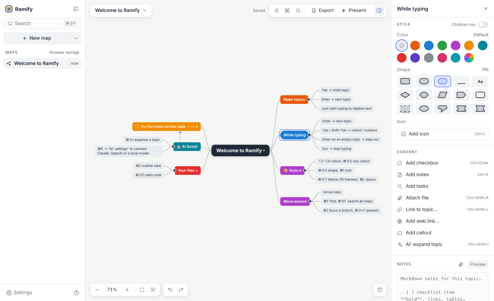

# Ramify

**A keyboard-first mind map for fast notes.** Use it for lectures, meetings, research and planning. You can build a whole map without touching the mouse, and every map is a plain Markdown file in a folder you choose. Free and open source.



*ramify* (v.): to branch out.

## Install

**macOS** (Homebrew)

```bash
brew tap almazy/tap
brew trust almazy/tap
brew install --cask ramify
```

**macOS** (manual): download the `.dmg` from [Releases](https://github.com/ALMAZY/ramify/releases/latest).

**Windows:** download the `.msi` or the `-setup.exe` from [Releases](https://github.com/ALMAZY/ramify/releases/latest).

**Linux:** download from [Releases](https://github.com/ALMAZY/ramify/releases/latest), for x64 or arm64:

- `.deb` for Debian, Ubuntu and Mint: `sudo apt install ./Ramify_*.deb`
- `.rpm` for Fedora and openSUSE: `sudo dnf install ./Ramify-*.rpm`
- `.AppImage` for any distro: `chmod +x Ramify_*.AppImage && ./Ramify_*.AppImage`

> **First launch.** The builds are not signed with a paid certificate yet, so your system may warn you once.
> - **macOS** (if you used the `.dmg`): open **System Settings → Privacy & Security** and click **Open Anyway**. You can also run `xattr -dr com.apple.quarantine /Applications/Ramify.app`. Homebrew installs skip this step.
> - **Windows** SmartScreen: click **More info → Run anyway**.

## Features

| | |
|---|---|
| **Keyboard-first** | Build and navigate whole maps without the mouse. `?` shows every shortcut. |
| **Command palette** | Every action on `⌘K`, with fuzzy search. |
| **Rich notes** | Markdown notes on any topic (`⌘E`): bold, links, tables, code, rendered in place. |
| **Task lists** | Checkbox topics (`⌘↩`) and `- [ ]` checklists inside notes, with a progress chip on the topic. |
| **Attachments** | Drop images, PDFs or any file on a topic, or press `⌘⇧A`. Images show on the map. |
| **Cross-links** | Connect any two topics with a dashed arrow (`⌘⇧L`). Jump along with `⌘G`. |
| **Daily notes** | `⌘⇧D` opens today's map in `Daily/YYYY-MM-DD.md`, the same naming as Obsidian. |
| **Search** | `⌘F` finds in the current map, `⌘⇧F` searches every map (text and notes). |
| **Node styles** | 9 colours plus any custom colour, 4 shapes, and 60+ icons. |
| **16 themes** | Light, dark and in between, with a live preview (`⌘⇧T`). |
| **4 layouts** | Mind map, tree right, tree left, org chart (`⌘L`). Saved per map. |
| **Outline view** | Edit the same map as a list (`⌘2`), the fastest way to type in a lecture. |
| **Folders** | Organise maps in sub-folders. Move a map with `⌘⇧M`. |
| **Present mode** | Full screen, one slide per branch, with notes as captions (`⌘⇧↩`). |
| **AI Assist** | Expand a topic, suggest next steps, summarise a branch, compare options. Use your own provider: Claude, OpenAI, OpenRouter, or a free local model with Ollama or LM Studio. |
| **Focus mode** | Zoom into one branch (`⌘]` / `⌘[`). |
| **Drag & drop** | Rearrange topics with the mouse, or `⌥` + arrows. |
| **Export** | PNG, PDF, SVG, Markdown (as headings or as a list), HTML, OPML, JSON, plain text. |
| **Import** | XMind, FreeMind/Freeplane, OPML, Markdown, plain text, JSON. |
| **Sync** | Your maps are files. Put the folder in iCloud Drive, Dropbox, OneDrive, Syncthing or git, and Ramify picks up changes from other devices live. |
| **Offline** | Everything works offline. No account and no server. |
| **Full undo** | Every change is reversible (`⌘Z` / `⌘⇧Z`). |

## Keyboard

`⌘` is `Ctrl` on Windows and Linux. Press `?` in the app for the full list.

| Topic selected | |
|---|---|
| `Tab` | New child topic |
| `Enter` / `Shift+Enter` | New topic below / above |
| Any letter, `Space`, `F2` | Start typing (a letter replaces the text) |
| Arrow keys | Move selection |
| `⌥` + arrows | Move topic up/down, in/out |
| `⌫` | Delete topic |
| `⌘.` | Fold / unfold |
| `⌘↩` | Toggle checkbox |
| `⌥1`–`⌥9` / `⌥0` | Colour / automatic (`⌘⇧C`: colour picker) |
| `⌘⇧S` / `⌘I` | Shape / icon |
| `⌘E` | Notes (Esc returns to the map) |
| `⌘⇧A` / `⌘⇧V` | Attach files / open an attachment |
| `⌘⇧L` / `⌘G` | Link to a topic / go to a linked topic |
| `⌘]` / `⌘[` | Focus in / out |
| `⌘C` `⌘X` `⌘V` `⌘D` | Copy, cut, paste, duplicate branch |
| `⌘⇧I` | AI: expand topic |

| Typing in a topic | |
|---|---|
| `Enter` | Next topic. On an empty topic: step out a level, or stop |
| `Tab` / `Shift+Tab` | Indent / outdent |
| `Shift+Enter` | Line break |
| `⌫` on an empty topic | Delete it and go back to the previous topic |
| `Esc` | Stop typing |

| Anywhere | |
|---|---|
| `⌘K` | Command palette |
| `⌘F` / `⌘⇧F` | Find in map / search all maps |
| `⌘N` / `⌘P` / `⌘⇧D` | New map / open map / daily note |
| `⌘1` / `⌘2` | Map / outline view |
| `⌘L` / `⌘⇧T` | Layout / theme |
| `⌘⇧↩` or `F5` | Present |
| `⌘0` `⌘=` `⌘-` | Fit, zoom in, zoom out |
| `⌘Z` / `⌘⇧Z` | Undo / redo |
| `⌘B` | Toggle sidebar |

## AI Assist

Run **⌘K → "AI: settings"** and pick a provider:

- **Claude (Anthropic API):** paste a key from console.anthropic.com.
- **OpenAI** or **OpenRouter:** paste a key and enter a model name.
- **Ollama** or **LM Studio:** free and private, running on your own computer. No key needed.

The key is stored only on your computer. Map text is sent only when you run an AI command, and only the branch you run it on (plus the path to it).

## File format

```markdown
---
ramify-layout: down
---
# Algorithms — Lecture 3 ^root
> Prof. Smith, room 204

- Quicksort <!--color:blue--> <!--shape:pill--> <!--link:ms1-->
  > Pivot choice matters.
  >
  > - [ ] re-read chapter 7
  > 
  - [ ] review partition
  - [x] average O(n log n)
- 🔥 Merge sort <!--collapsed--> ^ms1
  - stable
```

- `# heading` is the central topic. The file name follows it.
- Nested `-` items are topics, two spaces per level.
- `>` lines under an item are that topic's notes (Markdown, including checklists and attachments).
- `[ ]` / `[x]` makes a checkbox topic. A leading emoji is the topic's icon.
- `<!--color:…-->`, `<!--shape:…-->`, `<!--collapsed-->` and `<!--link:id-->` are hidden in Obsidian's reading view.
- `^id` at the end of an item is an Obsidian block id. Cross-links point to it.
- Attachments are copied into an `attachments/` folder inside your maps folder.
- `ramify-layout` in the front matter stores the map's layout. Other front matter is kept as it is.

Import is more lenient. It also accepts `##` headings, `*`/`+`/`1.` bullets, tabs and plain paragraphs.

## Build from source

You need [Node.js 20+](https://nodejs.org/) and [Rust](https://rustup.rs/).

- **macOS:** `xcode-select --install`
- **Linux:** the [Tauri prerequisites](https://tauri.app/start/prerequisites/) (webkit2gtk 4.1 and others)
- **Windows:** Microsoft C++ Build Tools and WebView2 (preinstalled on Windows 11)

```bash
npm install
npm run tauri dev      # desktop app with hot reload
npm run tauri build    # installers in src-tauri/target/release/bundle/
npm test               # unit tests
```

To work on the UI without Rust, run `npm run dev` and open http://localhost:1420. In a plain browser, maps are kept in localStorage.

## Project layout

```
src/
  model.ts      tree data, structural operations, undo history
  markdown.ts   Markdown <-> tree (the file format), headings export
  layout.ts     the four layouts, edge and link paths
  mapview.ts    map rendering, camera, mouse, inline editing, navigation
  outline.ts    outline view
  app.ts        state, commands, keyboard, saving, sync
  notes.ts      rendered notes, checklists, attachments
  themes.ts     16 themes          colors.ts   topic colours
  icons.ts      icon list          palette.ts  command palette
  present.ts    present mode       ai.ts / settings.ts   AI Assist
  importers.ts  XMind, FreeMind, JSON, OPML, Markdown, text
  exporter.ts   SVG, PNG, PDF, HTML, JSON, text
  storage.ts    folder storage (desktop) / localStorage (browser)
src-tauri/      Rust: files, folders, attachments, trash, open, HTTP for AI
tests/          Vitest tests
scripts/        release helpers (publish, Homebrew cask)
```

There's no UI framework, just TypeScript and DOM. Every action is a command in `app.ts → buildCommands()`, so a new command shows up in the palette and the help screen automatically. See [CONTRIBUTING.md](CONTRIBUTING.md).

## Roadmap

- [ ] Version history (browse and restore earlier versions)
- [ ] winget (Windows) and Flathub (Linux) packages
- [ ] Signed and notarized macOS build
- [ ] iPad / mobile

## Maintainers: releasing

1. Bump `version` in `package.json` and `src-tauri/tauri.conf.json`.
2. `git tag vX.Y.Z && git push origin vX.Y.Z`
3. GitHub Actions builds macOS (universal), Windows and Linux (x64 + arm64) and publishes the release.
4. The `homebrew` job updates `ALMAZY/homebrew-tap` when the repo has a `TAP_TOKEN` secret: a fine-grained token with **Contents: read and write** on `homebrew-tap` only. Without it, run `scripts/update-cask.sh vX.Y.Z` yourself.

## License

MIT © 2026 Aleksandrs Mazurs
